🛒 E-Commerce Flutter App

A modern, scalable, and production-ready E-Commerce mobile application built using Flutter, BLoC/Cubit, and a fully integrated REST API.
This application provides a complete shopping experience featuring authentication, product browsing, cart management, favorites, and a responsive UI/UX design.

🔥 Key Highlights

⚡ Built with Flutter 3+

🧠 Powered by BLoC Architecture & Cubit

🌐 Integrated with Dio REST API

🛍 Full e-commerce workflow (Auth → Home → Product → Cart → Checkout)

💾 Local caching using Shared Preferences

🎨 Clean UI + Modern User Experience

📱 Fully responsive layout for all screen sizes

🔐 Token-based secure authentication

📦 Clean and scalable folder structure

📸 UI Preview

(Insert your login/register screenshots here)

✨ Features Overview
🔐 User Authentication

Register a new account

Login with email & password

Save user token locally

Auto-login after restarting app

Logout functionality

Form validation + error handling

🏠 Home & Products

Fetch products from API

Dynamic categories

Product details page

High-resolution images

Smooth scrolling

❤️ Favorites System

Add/remove favorites

Favorites stored in API

Auto-sync with backend

Fast response using Cubit state

🛒 Cart System

Add to cart

Remove from cart

Modify item quantity

Real-time total price

Cart sync with API

Local state persistence

🧱 Project Architecture

This project follows a clean, layered, and scalable architecture using BLoC / Cubit:

lib/
│
├── core/
│   ├── network/
│   │   ├── dio_helper.dart
│   │   └── endpoints.dart
│   ├── styles/
│   ├── constants/
│
├── data/
│   ├── models/
│   ├── repository/
│
├── modules/
│   ├── auth/
│   │   ├── login_screen.dart
│   │   └── register_screen.dart
│   ├── home/
│   ├── cart/
│   ├── favorites/
│   └── product_details/
│
└── cubit/
    ├── auth_cubit/
    ├── home_cubit/
    ├── cart_cubit/
    └── favorite_cubit/

🧠 State Management

The app uses Cubit for lightweight logic and BLoC for more complex workflows.

Why BLoC/Cubit?

Predictable state transitions

Clear separation between UI and logic

Testable & maintainable

Excellent performance

Industry-grade architecture

Each module has its own Cubit to avoid huge classes.

🌐 API Integration (Dio)

GET / POST / PUT / DELETE support

Error handling

Token management

Network logging

Retry strategy (optional)

Base URL configuration

📦 Packages Used
flutter_bloc
bloc
dio
shared_preferences
cached_network_image
google_fonts
flutter_svg
smooth_page_indicator

▶️ Setup Instructions
1. Clone the repository
git clone https://github.com/your-repo/ecommerce-flutter-app.git

2. Install dependencies
flutter pub get

3. Configure the API

Update your base URL inside:

lib/core/network/dio_helper.dart

4. Run the app
flutter run

🔧 Environment Configuration

This project supports multiple environments:

Development

Production

You can configure them from the network folder.

🧪 Testing Support

Unit tests for Cubits

API mock testing

Widget testing ready

🚀 Performance Optimizations

Cached network images

Lazy API loading

Lightweight Cubit stores

Reduced widget rebuilds

Optimized rebuild logic

Constant reuse & style extraction

🛡️ Security

Token protection

Secure HTTP requests

Validation on all forms

Server error handling

🤝 Contribution Guide

Contributions are always welcome!

Fork the repo

Create a new branch

Commit changes

Open a pull request

📝 License

This project is open-source and free to use.

this is some Images from app

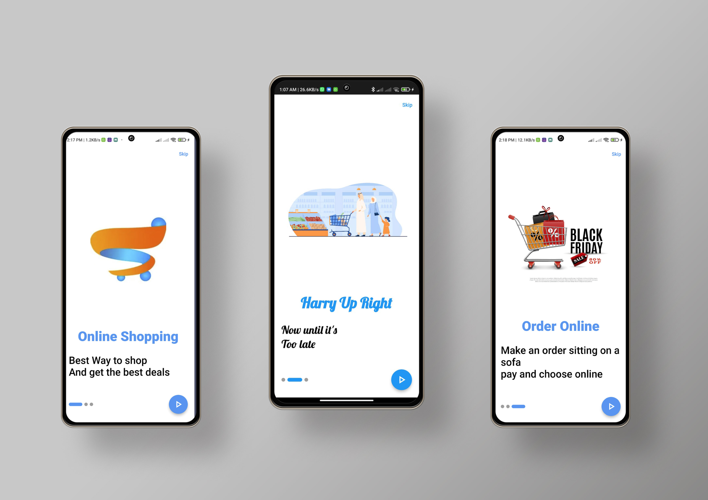
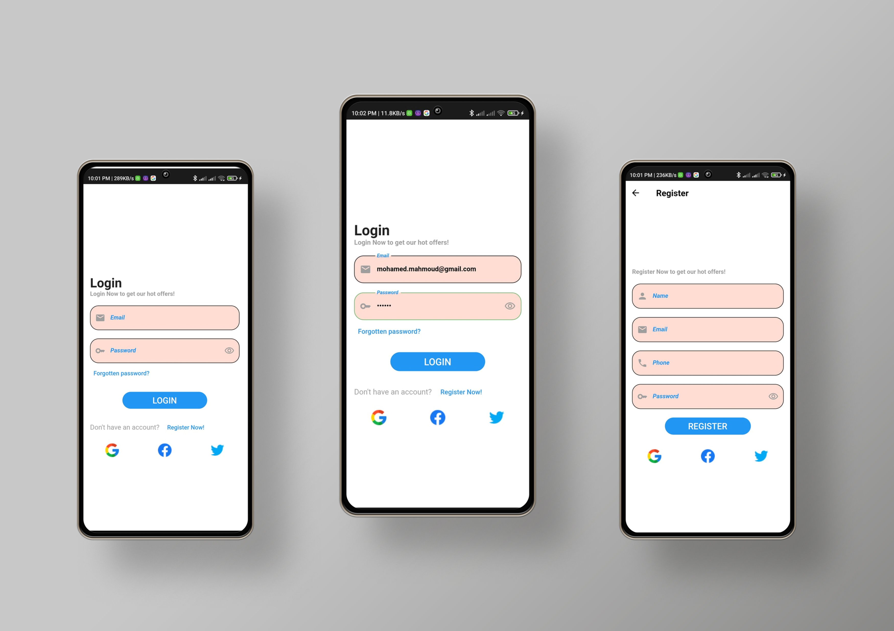
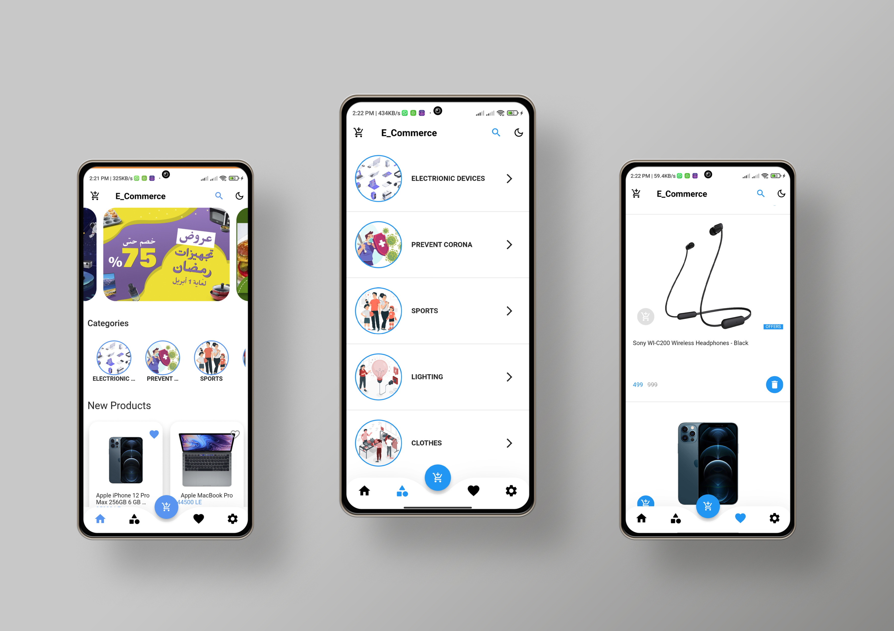
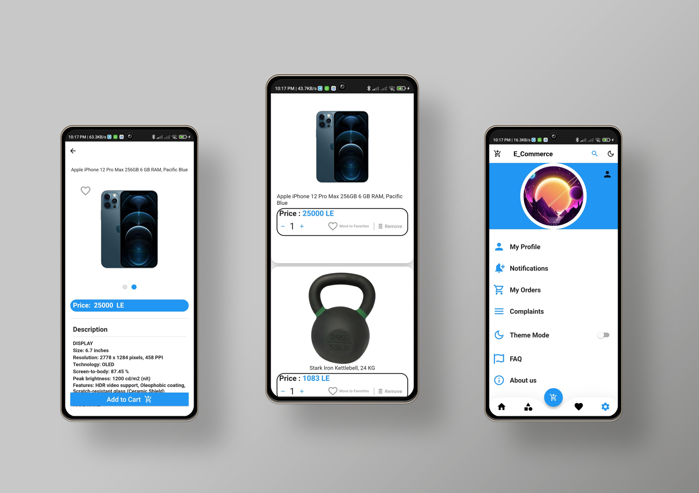
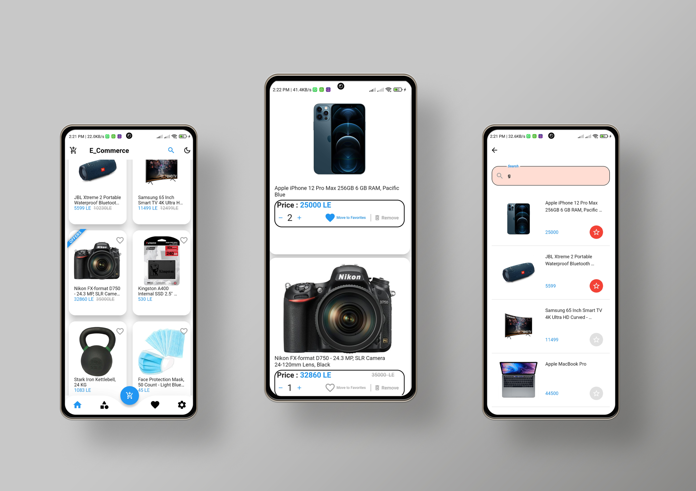
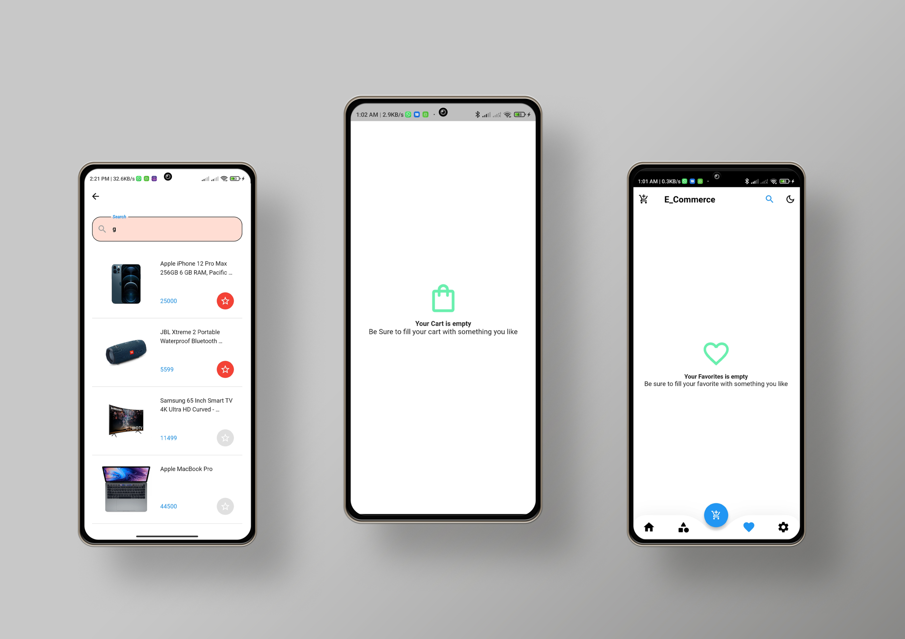
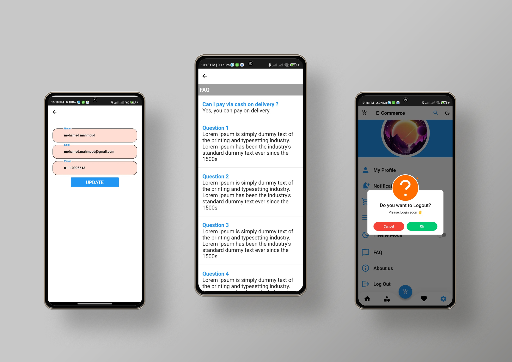
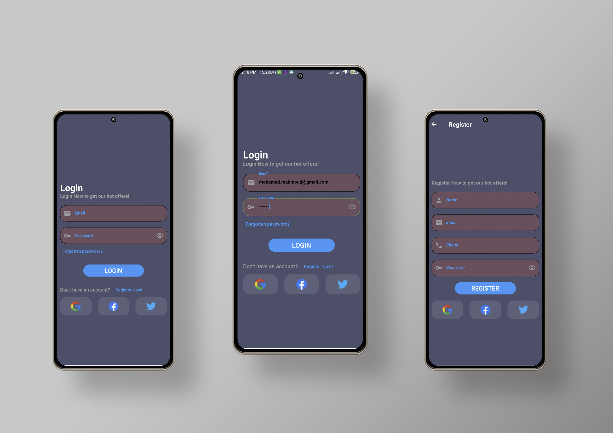
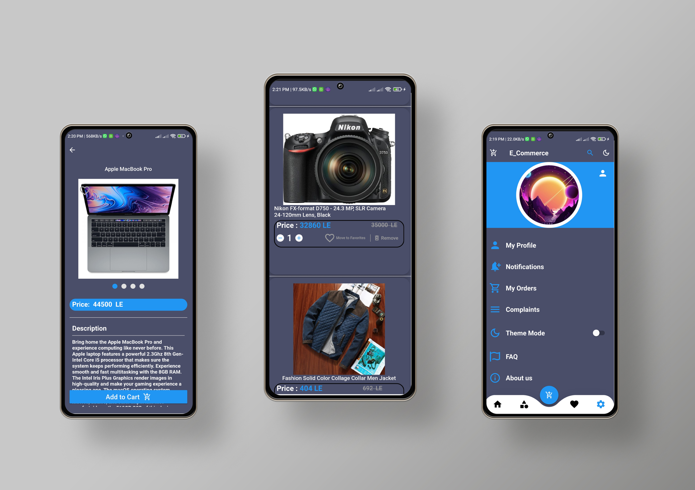
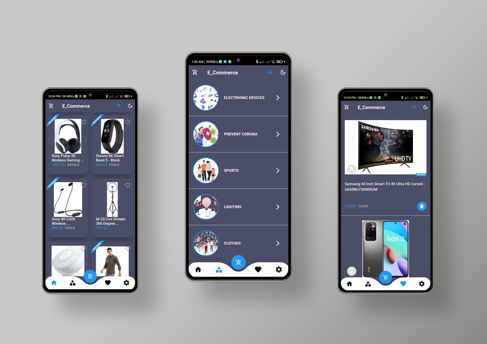
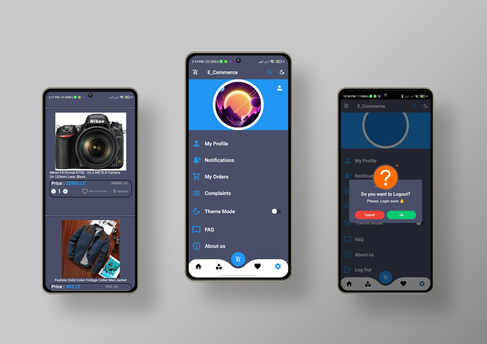

